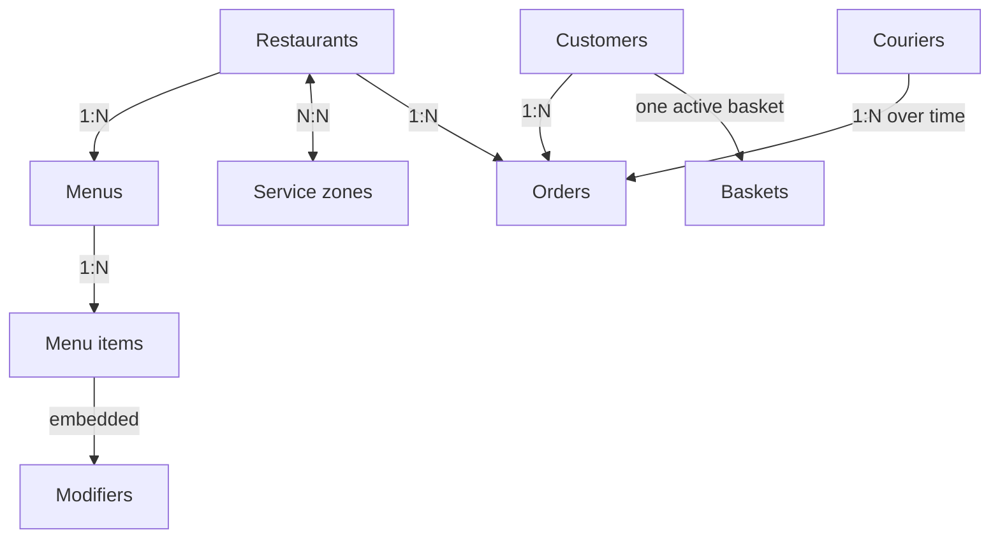

# FoodGuyde — MongoDB Data Model

> **NoSQL System Design — Project 10**  
> **Application:** Restaurant and Menu Search with Delivery Orders  
> **Database:** `food_delivery`  
> **Status:** Initial design — to be expanded

---

## Contents

1. [Overview](#1-overview)
2. [Technology responsibilities](#2-technology-responsibilities)
3. [MongoDB collections](#3-mongodb-collections)
4. [Representative documents](#4-representative-documents)
5. [Collection relationships](#5-collection-relationships)
6. [Relationship diagram](#6-relationship-diagram)
7. [Design decisions](#7-design-decisions)
8. [Next design tasks](#8-next-design-tasks)

## 1. Overview

FoodGuyde is a proposed restaurant-delivery application inspired by DoorDash. Customers can search for restaurants and dishes, inspect menus, place orders, and follow deliveries. Restaurants can change opening status and menu-item availability; couriers can report progress.

**MongoDB is the authoritative operational database** for restaurant and menu information, customer orders, and current delivery status. Before confirming an order, the application must recheck the current restaurant and item availability.

## 2. Technology responsibilities

| Technology | Type | Responsibility |
|---|---|---|
| **MongoDB** | NoSQL document database | Current restaurants, menus, orders, customers, couriers, delivery zones |
| **Redis** | NoSQL key-value store | Cache frequently requested data; never the final authority at checkout |
| **Apache Cassandra** | NoSQL wide-column database | Historical status events and time-window demand views |
| **Apache Kafka** | Event-streaming platform | Carry menu, order, restaurant-status, and delivery events |
| **MongoDB Search** | Search capability | Full-text restaurant/menu searches and relevance ranking |
| **MongoDB geospatial indexes** | Indexing capability | Location lookups and delivery-zone matching |

*This document specifies a proposed design; no implementation is claimed.*

## 3. MongoDB collections

| Collection | Purpose |
|---|---|
| `restaurants` | Restaurant identity, cuisine, rating, location, opening status |
| `menus` | Menus owned by restaurants |
| `menu_items` | Dish descriptions, prices, availability, dietary tags, modifiers |
| `service_zones` | Geographic areas served by restaurants |
| `customers` | Customer profiles and delivery addresses |
| `baskets` | Unconfirmed items selected by customers |
| `orders` | Submitted orders, purchased-item snapshots, total and current status |
| `couriers` | Couriers, availability and latest known locations |

## 4. Representative documents

These are **illustrative examples**, not imported production data. IDs use readable strings for clarity in the design report.

### 4.1 Restaurant (`restaurants`)

```json
{
  "_id": "rest_001",
  "name": "Burger House",
  "cuisine": "American",
  "rating": 4.7,
  "isOpen": true,
  "location": {
    "type": "Point",
    "coordinates": [35.5018, 33.8938]
  },
  "serviceZoneIds": ["zone_001"]
}
```

**Notes:** The location uses GeoJSON `Point` coordinates in **[longitude, latitude]** order. `serviceZoneIds` references delivery-zone documents.

### 4.2 Menu item (`menu_items`)

```json
{
  "_id": "item_001",
  "restaurantId": "rest_001",
  "menuId": "menu_001",
  "name": "Chicken Burger",
  "description": "Grilled chicken burger with cheese",
  "price": 8.50,
  "currency": "USD",
  "available": true,
  "dietaryTags": [],
  "modifiers": [
    { "name": "Extra Cheese", "additionalPrice": 1.50 }
  ]
}
```

**Notes:** `restaurantId` and `menuId` are references. `modifiers` are embedded because they are usually retrieved with the menu item.

### 4.3 Order (`orders`)

```json
{
  "_id": "order_001",
  "customerId": "cust_001",
  "restaurantId": "rest_001",
  "items": [
    {
      "itemId": "item_001",
      "name": "Chicken Burger",
      "quantity": 2,
      "unitPrice": 8.50
    }
  ],
  "totalAmount": 17.00,
  "currency": "USD",
  "status": "pending",
  "courierId": null
}
```

**Notes:** Order items are embedded snapshots of purchased names and prices. Checkout must validate actual availability before confirmation; a basket or search result alone is not sufficient.

## 5. Collection relationships

| Source | Relationship | Target | Implementation idea |
|---|---|---|---|
| Restaurant | One-to-many | Menus | `menus.restaurantId` reference |
| Menu | One-to-many | Menu items | `menu_items.menuId` reference |
| Menu item | One-to-many | Modifiers | Embedded `modifiers` array |
| Restaurant | Many-to-many | Service zones | Restaurant stores zone IDs |
| Customer | One-to-many | Orders | `orders.customerId` reference |
| Customer | One active basket (design rule) | Basket | `baskets.customerId` reference |
| Restaurant | One-to-many | Orders | `orders.restaurantId` reference |
| Courier | One-to-many over time | Orders | Optional `orders.courierId` reference |

## 6. Relationship diagram



This diagram represents **logical relationships**, not enforced SQL foreign keys. The final data-model diagram will be refined after all fields and references are defined.

## 7. Design decisions

- **Documents and references:** Keep independently updated restaurants, menus, items, and orders in separate collections linked by IDs.
- **Embedding:** Embed small modifiers in menu items and purchased-item snapshots in orders to support common reads and historical accuracy.
- **Authoritative checkout:** Confirm orders only after current availability checks with suitable concurrency/transaction controls in MongoDB.
- **Search and caching:** Search indexes and Redis may temporarily lag behind MongoDB. They must not approve an order.
- **Historical events:** Cassandra holds event history and derived time-window demand; Kafka transports events between services.
- **Alternatives:** Elasticsearch is a possible dedicated search-engine alternative but is not selected because MongoDB Search is adequate for the proposed workload. Storing all event history in MongoDB is another alternative to compare with Cassandra.

## 8. Next design tasks

1. Define full fields and types for each collection.
2. Specify data validation and detailed embedding-versus-referencing choices.
3. Design MongoDB Search indexes, filters, and sample queries.
4. Design GeoJSON delivery zones and `2dsphere` index queries.
5. Design Redis keys, expiration and invalidation rules.
6. Compare sharding by restaurant ID versus delivery-zone ID, including hot partitions.
7. Complete the architecture and data-flow diagrams with Member 2.
