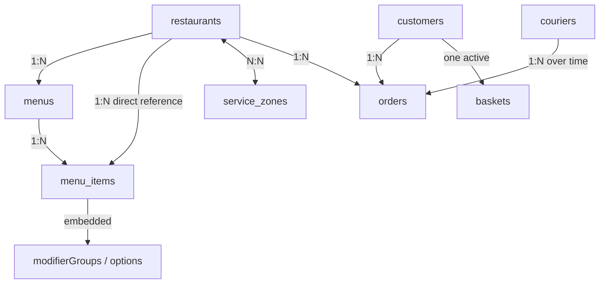

# FoodGuyde — MongoDB Data Model

**Project:** Restaurant and Menu Search with Delivery Orders (Project 10)  
**Workstream:** Member 1 — Task 1: MongoDB Data Modeling  
**Database:** `food_delivery`  
**Scope:** Collections, fields, relationships, example documents, expected growth, and embedding vs. referencing

---

## 1. Purpose and modeling assumptions

FoodGuyde is a proposed food-delivery service in which customers discover restaurants, browse menus, submit orders, and track delivery progress. Restaurants update opening status and menu availability, while couriers update their latest locations.

MongoDB is the **authoritative operational database** for restaurant status, menu availability, baskets, orders, and current delivery state. This document describes the **proposed data model**, not an implemented database.

The design uses the following conventions:

- Each collection stores one type of entity. A **collection** contains many **documents**.
- IDs are readable strings in the examples (`rest_001`, `order_001`) for clarity. A production implementation could instead use BSON `ObjectId` values or another consistent ID scheme.
- Prices are stored as **integer minor units** (`priceCents`, in US cents) to avoid floating-point rounding errors.
- Locations use **GeoJSON**, with coordinates ordered **[longitude, latitude]**.
- Timestamps appear as ISO 8601 strings in the JSON examples; an actual MongoDB implementation should use the BSON `Date` type.
- All records and names below are **illustrative synthetic data**.

## 2. Collections and responsibilities

| Collection | What one document represents | Main responsibility |
|---|---|---|
| `restaurants` | One restaurant | Identity, cuisines, rating, location, and current opening status |
| `menus` | One restaurant menu | Menu title, restaurant reference, and whether the menu is active |
| `menu_items` | One dish or product | Searchable dish details, price, current availability, and modifiers |
| `service_zones` | One geographic delivery area | Service-area boundary that restaurants can reference |
| `customers` | One customer | Profile and saved delivery addresses |
| `baskets` | One active customer basket | Selected items and quantities before checkout |
| `orders` | One submitted order | Purchased-item snapshots, totals, and current order state |
| `couriers` | One delivery courier | Current availability and latest reported position |

**Why eight collections?** Restaurants, menus, items, zones, customers, orders, and couriers change independently and have different lifecycles. Baskets are also separate because they change frequently before an order exists.

## 3. Fields and data types

The types below are MongoDB/BSON-oriented. `string`, `boolean`, `int`, `double`, `array`, `object`, and `date` are descriptive types; some geographic and embedded values use nested objects.

### 3.1 `restaurants`

| Field | Type | Meaning / constraint |
|---|---|---|
| `_id` | string | Unique restaurant ID |
| `name` | string | Required, nonempty name |
| `cuisines` | array of strings | One or more cuisine tags |
| `rating` | double | Aggregate rating, from 0 to 5 |
| `isOpen` | boolean | Current acceptance of new orders |
| `location` | GeoJSON Point object | Restaurant coordinates |
| `serviceZoneIds` | array of strings | References to `service_zones._id` |
| `updatedAt` | date | Time of latest restaurant update |

### 3.2 `menus`

| Field | Type | Meaning / constraint |
|---|---|---|
| `_id` | string | Unique menu ID |
| `restaurantId` | string | References `restaurants._id` |
| `title` | string | Menu name, e.g. `Main Menu` |
| `isActive` | boolean | Whether this menu is published |
| `sortOrder` | int | Display order among menus |
| `updatedAt` | date | Time of latest menu update |

### 3.3 `menu_items`

| Field | Type | Meaning / constraint |
|---|---|---|
| `_id` | string | Unique item ID |
| `restaurantId` | string | Restaurant reference, included for direct restaurant-based reads |
| `menuId` | string | References `menus._id` |
| `name` | string | Dish name |
| `description` | string | Dish description |
| `category` | string | e.g. `Burgers` |
| `priceCents` | int | Base price in minor currency units; nonnegative |
| `currency` | string | Currency code, e.g. `USD` |
| `available` | boolean | Current item availability |
| `dietaryTags` | array of strings | e.g. `vegetarian`, `gluten-free` |
| `modifierGroups` | array of objects | Embedded choices and extra prices |
| `updatedAt` | date | Time of latest item update |

### 3.4 `service_zones`

| Field | Type | Meaning / constraint |
|---|---|---|
| `_id` | string | Unique zone ID |
| `name` | string | Human-readable delivery-area name |
| `boundary` | GeoJSON Polygon object | Geographic boundary, with closed coordinate rings |
| `isActive` | boolean | Whether the zone is currently available for service |
| `updatedAt` | date | Time of latest zone update |

### 3.5 `customers`

| Field | Type | Meaning / constraint |
|---|---|---|
| `_id` | string | Unique customer ID |
| `displayName` | string | Customer display name |
| `email` | string | Contact email; unique if used for login |
| `addresses` | array of objects | Embedded saved labels and GeoJSON points |
| `createdAt` | date | Account creation time |

### 3.6 `baskets`

| Field | Type | Meaning / constraint |
|---|---|---|
| `_id` | string | Unique basket ID |
| `customerId` | string | References `customers._id` |
| `restaurantId` | string | References `restaurants._id`; one restaurant per basket |
| `items` | array of objects | Selected item IDs, quantities, and modifier selections |
| `updatedAt` | date | Last basket change |

**Design rule:** At most one active basket per customer in this simplified model. Basket information is provisional: displayed prices and availability must be rechecked during checkout.

### 3.7 `orders`

| Field | Type | Meaning / constraint |
|---|---|---|
| `_id` | string | Unique order ID |
| `customerId` | string | References `customers._id` |
| `restaurantId` | string | References `restaurants._id` |
| `items` | array of objects | Embedded snapshots of purchased items, quantities, modifiers, and prices |
| `subtotalCents` | int | Sum of confirmed item prices |
| `deliveryFeeCents` | int | Delivery charge |
| `totalCents` | int | Sum due, in minor currency units |
| `currency` | string | Currency code |
| `deliveryLocation` | GeoJSON Point object | Destination snapshot at checkout |
| `status` | string | Current state: `pending`, `accepted`, `preparing`, `prepared`, `picked_up`, `delivered`, or `cancelled` |
| `courierId` | string or null | Optional reference to `couriers._id` |
| `createdAt` | date | Submission time |
| `updatedAt` | date | Last state update |

**Checkout rule:** The service must check current restaurant and item availability before creating a confirmed/submitted order; basket contents or search results alone are not trusted.

### 3.8 `couriers`

| Field | Type | Meaning / constraint |
|---|---|---|
| `_id` | string | Unique courier ID |
| `displayName` | string | Courier display name |
| `isAvailable` | boolean | Whether courier can accept work |
| `lastLocation` | GeoJSON Point object | Most recently reported coordinates |
| `lastLocationAt` | date | Time of the location report |

## 4. Representative JSON documents

The eight examples share consistent IDs. The timestamps below are strings for readable JSON; they represent BSON Date values in MongoDB.

### 4.1 Restaurant

```json
{
  "_id": "rest_001",
  "name": "Burger House",
  "cuisines": ["American", "Burgers"],
  "rating": 4.7,
  "isOpen": true,
  "location": {
    "type": "Point",
    "coordinates": [35.5018, 33.8938]
  },
  "serviceZoneIds": ["zone_001"],
  "updatedAt": "2026-11-13T17:00:00Z"
}
```

### 4.2 Menu

```json
{
  "_id": "menu_001",
  "restaurantId": "rest_001",
  "title": "Main Menu",
  "isActive": true,
  "sortOrder": 1,
  "updatedAt": "2026-11-13T17:00:00Z"
}
```

### 4.3 Menu item with embedded modifiers

```json
{
  "_id": "item_001",
  "restaurantId": "rest_001",
  "menuId": "menu_001",
  "name": "Chicken Burger",
  "description": "Grilled chicken burger with cheese",
  "category": "Burgers",
  "priceCents": 850,
  "currency": "USD",
  "available": true,
  "dietaryTags": [],
  "modifierGroups": [
    {
      "name": "Extras",
      "maxSelections": 2,
      "options": [
        { "code": "extra_cheese", "name": "Extra Cheese", "additionalPriceCents": 150 }
      ]
    }
  ],
  "updatedAt": "2026-11-13T17:00:00Z"
}
```

### 4.4 Service zone

```json
{
  "_id": "zone_001",
  "name": "Central Beirut Delivery Zone",
  "boundary": {
    "type": "Polygon",
    "coordinates": [
      [
        [35.49, 33.88],
        [35.52, 33.88],
        [35.52, 33.91],
        [35.49, 33.91],
        [35.49, 33.88]
      ]
    ]
  },
  "isActive": true,
  "updatedAt": "2026-11-13T17:00:00Z"
}
```

### 4.5 Customer with embedded addresses

```json
{
  "_id": "cust_001",
  "displayName": "Alex",
  "email": "alex@example.com",
  "addresses": [
    {
      "label": "Home",
      "location": {
        "type": "Point",
        "coordinates": [35.505, 33.895]
      }
    }
  ],
  "createdAt": "2026-11-01T10:00:00Z"
}
```

### 4.6 Active basket

```json
{
  "_id": "basket_001",
  "customerId": "cust_001",
  "restaurantId": "rest_001",
  "items": [
    {
      "itemId": "item_001",
      "quantity": 2,
      "selectedModifiers": []
    }
  ],
  "updatedAt": "2026-11-13T17:50:00Z"
}
```

### 4.7 Submitted order with item snapshot

```json
{
  "_id": "order_001",
  "customerId": "cust_001",
  "restaurantId": "rest_001",
  "items": [
    {
      "itemId": "item_001",
      "name": "Chicken Burger",
      "quantity": 2,
      "unitPriceCents": 850,
      "selectedModifiers": [],
      "lineTotalCents": 1700
    }
  ],
  "subtotalCents": 1700,
  "deliveryFeeCents": 200,
  "totalCents": 1900,
  "currency": "USD",
  "deliveryLocation": {
    "type": "Point",
    "coordinates": [35.505, 33.895]
  },
  "status": "pending",
  "courierId": null,
  "createdAt": "2026-11-13T18:00:00Z",
  "updatedAt": "2026-11-13T18:00:00Z"
}
```

### 4.8 Courier

```json
{
  "_id": "courier_001",
  "displayName": "Sam",
  "isAvailable": true,
  "lastLocation": {
    "type": "Point",
    "coordinates": [35.508, 33.897]
  },
  "lastLocationAt": "2026-11-13T17:58:00Z"
}
```

## 5. Relationships and cardinality

| From | Relationship | To | Representation |
|---|---|---|---|
| `restaurants` | One-to-many | `menus` | `menus.restaurantId` references restaurant |
| `menus` | One-to-many | `menu_items` | `menu_items.menuId` references menu |
| `restaurants` | One-to-many | `menu_items` | `menu_items.restaurantId` enables direct restaurant-based access |
| `menu_items` | One-to-many (embedded) | Modifiers | `modifierGroups` inside each item document |
| `restaurants` | Many-to-many | `service_zones` | `restaurants.serviceZoneIds` contains zone IDs |
| `customers` | One-to-many | `orders` | `orders.customerId` references customer |
| `customers` | One active basket | `baskets` | `baskets.customerId` references customer |
| `restaurants` | One-to-many | `orders` | `orders.restaurantId` references restaurant |
| `couriers` | One-to-many over time | `orders` | Optional `orders.courierId` references courier |

References describe **logical relationships**. Unlike SQL foreign keys, MongoDB does not automatically enforce these cross-collection references; the application must maintain their validity.

### Relationship diagram



## 6. Embedding vs. referencing decisions

| Data | Decision | Reason |
|---|---|---|
| Menu-item modifiers | **Embed** in `menu_items` | Read together with a dish; normally small and bounded |
| Purchased items in an order | **Embed snapshots** in `orders` | Preserve price and description at purchase time even if menu later changes |
| Saved customer addresses | **Embed** in `customers` | Typically few addresses, read with profile |
| Basket item selections | **Embed** in `baskets` | One basket is usually retrieved and modified as a unit |
| Restaurants and menus | **Reference** | Menus can be updated independently; avoid duplicating restaurant data |
| Menus and menu items | **Reference** | Menu items change frequently and can be numerous |
| Restaurants and service zones | **Reference** | A zone can be shared by multiple restaurants and updated independently |
| Orders, customers, restaurants, couriers | **Reference** | Each is a separate, long-lived entity with independent updates |

**Trade-off:** Embedding improves common reads but makes documents larger and repeated edits more expensive. Referencing keeps independently changing data separate, but retrieving related records may require more than one query. In MongoDB, **unbounded arrays should be avoided**: do not embed every lifetime order inside a restaurant or customer document.

## 7. Expected data growth and modeling implications

The assignment assumes **millions of daily orders**, with demand concentrated in a small number of geographic areas during busy periods. The following growth patterns inform the schema; they are planning assumptions, not measured results.

| Data | Expected growth or update pattern | Modeling implication |
|---|---|---|
| Restaurants | Moderate growth; opening status can change often | Separate restaurant documents and direct status updates |
| Menus and items | Many items per restaurant; prices/availability change repeatedly | Separate item documents and bounded embedded modifiers |
| Service zones | Relatively small number; polygons may change | Shared zone documents rather than duplicated boundaries in every restaurant |
| Customers | Long-term growth | Separate customer documents and bounded embedded addresses |
| Baskets | High write frequency; temporary | Separate mutable basket documents |
| Orders | Very high, continuing growth | One document per order; no embedded lifetime order arrays |
| Couriers | Repeated location updates | Store only latest known position in the courier document |

For illustration, **1 million orders per day** corresponds to roughly **365 million order documents per year**, before archiving or retention decisions. Therefore, orders should be modeled as independent records rather than as a growing array inside a customer or restaurant.

Historical status-event storage is outside the scope of this MongoDB model: this document covers the **current operational state** of orders and couriers.

## 8. Modeling justification and limitations

**Why MongoDB suits this data model:** It represents varied restaurant and food records as flexible documents, supports bounded nested arrays such as modifiers and purchased-item snapshots, and can store geographic shapes and points in a standard representation.

**Limitations and design safeguards:**

- References across collections are not foreign-key constraints; the application must validate them.
- Restaurant and menu updates can occur while customers are browsing. **Availability must be checked again at checkout** against current authoritative records.
- Nested arrays must stay bounded to prevent oversized documents.
- Updating many related documents may require careful transactional or conditional-write logic; this document specifies the model, not the checkout algorithm.
- `rating` is treated as a maintained aggregate, not an automatically calculated value.
- The sample service zone is a **simplified illustrative polygon**, not a real validated business delivery boundary.

---

*FoodGuyde — Member 1 / Task 1: MongoDB Data Modeling*
